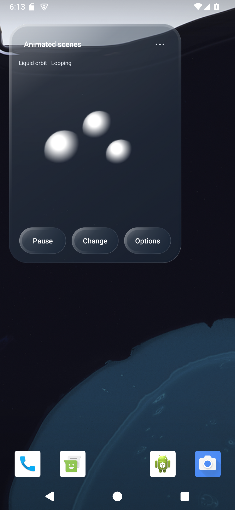
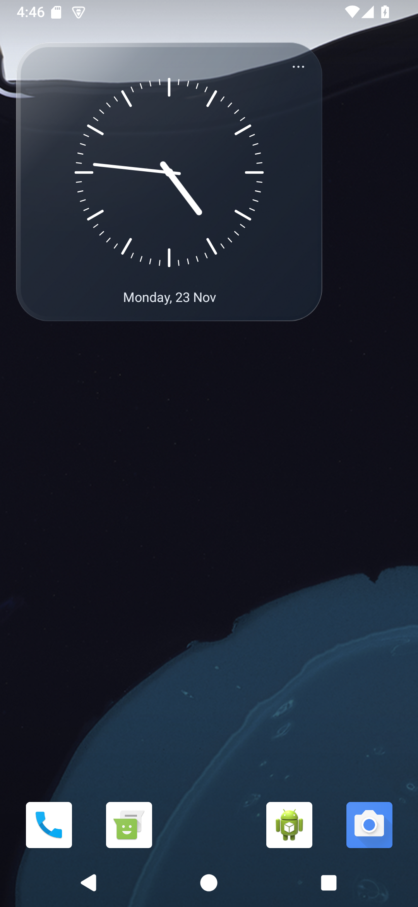
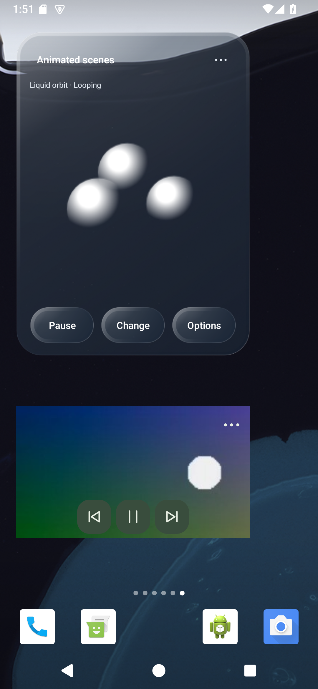

# Nook

A native Android home screen widget collection with a coordinated, customizable design. Android 9 or newer. No Nook account required; optional weather uses Open-Meteo.

Choose 37 dedicated tools or one Universal widget that switches between them. Apple, macOS, Pixel, Samsung, and Nothing catalogs offer named stock-family counterparts, with classic and Liquid Glass appearances. Version 0.12.0.

**[Download the latest APK](https://github.com/SamsDevForge/nook-widgets/releases/latest/download/Nook.apk)** · [Latest release and checksums](https://github.com/SamsDevForge/nook-widgets/releases/latest) · [Installation](#install) · [Build from source](#build) · [Verification report](dist/verification.md)

Nook includes temporary and permanent notes, reminders, timer/alarm shortcuts, clocks, calendars, weather, personal trackers, redesigned music controls, animated scenes, photo slideshows and full-length silent video. Use a dedicated widget for one task or switch tools inside Universal. Everything uses native Android widgets and Java, with no third-party runtime libraries, ads, analytics or Nook account.

<p>
  
  
  
</p>

Native Android captures; the photos and video used in media previews are generated sample content. [Watch the home screen animation](dist/previews/motion-homescreen.mp4).

## Widgets

| Widget | Options |
| --- | --- |
| Universal widget | Seven pages of up to six tools; switch between all 37 views inside one home screen slot |
| Quick notes | Permanent or temporary notes; countdown or chosen expiry time; pin one note or show recent active notes |
| Gentle reminders | All upcoming reminders or those due today, including overdue; tap a row to complete it |
| Quick timers | Everyday, Focus, and Kitchen presets; three custom durations from 1 to 1440 minutes |
| Quick alarms | Morning, Early Start, and Slow Morning presets; three custom alarm times |
| Daily checklist | Show unfinished tasks or all tasks; complete tasks on the home screen |
| Daily habits | Progress bar or simple counter; select a habit, set a daily target, and check in with +/− |
| Day clock | Live 12-hour or 24-hour clock with date |
| Phone battery | Real phone percentage and charging status; ring or large percentage/details |
| Month calendar | Current month or week, today's highlight, Sunday/Monday week starts, optional event dots |
| Upcoming agenda | Read-only events from visible phone calendars; next 7 or 30 days; tap an event to open it |
| Local weather | Chosen city, Celsius/Fahrenheit, current conditions or three-day highs/lows; offline cache |
| Photo frame | Scoped photo picker, crop/fit options, optional caption |
| World clocks | Search for three cities; one or three native live clocks; 12/24-hour formats and daylight-saving changes |
| Event countdown | Calendar days until an occasion, or days since it; large day count |
| Favorite contacts | One or three named favorites; opens the dialer without placing a call |
| Web search | Google, DuckDuckGo, or Bing; typed or supported voice input |
| Quick controls | Three editable shortcuts to settings panels, calculator, or camera |
| Now playing | Four artwork layouts, preferred player, elapsed time, session-bound controls, and expanded seeking/queue/volume |

Every widget has eight design languages, six palettes (Moss, Ink, Sand, Lilac, Rose, Sky), four surfaces (Solid, Frosted, Smoked, Liquid Glass), spacious and compact layouts, and a custom label. Add multiple copies with independent settings. Resize with your launcher; tap **···** to customize a placed widget.

The additional dedicated tools are:

| Widget | Data and actions |
| --- | --- |
| Stopwatch | Native live chronometer; start, pause, resume, lap and reset |
| Compass | Foreground magnetic sensor reading; widget retains the last measurement |
| Voice memos | Microphone permission at use; private capture and playback; stops on leaving the recorder |
| Screen time | Optional usage access; Android-reported foreground app time |
| Device care | Actual storage use and available memory; opens storage settings |
| Personal tracker | Manual activity rings, water, reading, steps, sleep or medication check-ins; your own targets |
| Files | Up to three individually selected documents |
| Bookmarks | Saved links to open in your browser |
| App shortcuts | Up to three installed apps you choose |
| Saved places | Destination shortcuts that open directions in Maps/browser |
| Translate | Enter text and explicitly open Google Translate |
| Breathing | Foreground Box, 4–7–8 or Steady guide |
| Headlines | Your HTTPS RSS/Atom source; manual Refresh, cached stories and source links |
| Stocks | Alpha Vantage key and symbol; provider quote, change and trading date; manual Refresh |
| Service card | Your own card content or an installed-app shortcut; visible source label |
| Tips | Original Nook usage tips with previous/next controls |
| Animated scenes | Liquid orbit, soft pulse, ripple and dot wave; pace, pause/resume and change controls |
| Photo slideshow | Up to six chosen photos; fade/cut, crop/fit, 2–60 seconds per photo, pause and next |
| Video carousel | Full-length silent playback inside the widget, up to 12 videos, Previous/Next, pause, native aspect and hidden text |

## Animations and video

Open **Widgets → Motion** to find the three new tools, or **Widgets → Video** for the video carousel. They can also be selected inside Universal. All eight designs, four surfaces, transparency and appearance options remain available.

**Animated scenes** offers four original looping compositions: Liquid orbit, Soft pulse, Ripple and Dot wave. Choose Lively, Gentle or Slow. Pause/Resume and Change work from the widget. These use Android's native view animation/sequence support in the launcher, without a continuously running Nook service or repeated background widget updates.

**Photo slideshow** uses up to six images chosen through Android's document picker. Select Soft fade or Direct cut, Crop or Fit, and 2–60 seconds per photo. Pause motion for a still image; Next changes the photo. Unavailable or removed photos are skipped. Each copy has its own choices.

**Video carousel** plays the full selected video **inside the home screen widget, silently**. Choose **Full video · silent inline**, select up to 12 local videos, and use the icon controls for Previous, Pause/Play and Next. Both directions wrap around the carousel. Each widget copy keeps its own selection and pause state; this also works inside Universal.

Choose **Hide all text · icons only** to remove labels, filenames and counters. **Match the selected video** chooses a landscape, square or portrait provider when adding the widget through Nook. Rotation metadata is respected. **Fit** preserves the entire video; **Fill** crops its edges. Android launchers control the outer grid size: long-press to resize a placed widget. Switching to a differently shaped video fits it into the existing space, without changing neighboring home screen items.

Inline playback streams frames from the complete video using Android's decoder and an adapter-backed native widget view. It is a silent, lower-resolution presentation (up to a 320-pixel long edge), with 3, 5 or 8 requested frames per second. It is not a full-frame-rate video surface, and performance depends on the codec, phone, launcher and power settings. The launcher keeps a bounded collection cache; Nook does not bake the entire video into memory or run a repeating foreground-service widget update loop. **Still poster** and a **1–6 second short loop** remain optional modes.

Selected files are read locally and are never uploaded or modified. The document picker grants lasting read access; posters and paused frames are stored privately. If a source moves, becomes inaccessible or uses an unsupported format, select it again or choose another supported file. Removing it from the carousel leaves the original file intact. Uninstalling clears Nook's private data.

For optional full-resolution playback with audio, a placed widget's Options screen offers **Open saved video in full-screen player**. That player includes seeking, mute/unmute and Android picture-in-picture. Normal widget transport stays inside the widget.

Native tests use generated videos and check visible playback past six seconds, the end and wraparound of a 12-second source, real carousel controls, pause/resume, orientation, aspect providers and Universal integration. [Actual home screen capture](dist/screenshots/inline-video-homescreen.png) · [15-second launcher recording](dist/previews/inline-video-homescreen.mp4) · [Generated 12-second source](dist/previews/inline-proof-source.mp4).

## Music and podcasts

Choose **Now playing** and one of four layouts:

- **Album Card:** artwork, title, artist, album, timeline and large playback controls.
- **Compact player:** a one-row bar with artwork and controls; Nook offers a dedicated 4×1 provider when adding this layout.
- **Cover Art:** the album cover fills the card with a shaded backdrop for readable text and controls.
- **Vinyl:** album art becomes the center label of a native record illustration.

All eight design languages, Liquid Glass, transparency and typography options remain available. Choose square, rounded or circular artwork, artwork-based tinting for solid cards, optional album/player labels, and an artwork-and-controls mode with all text hidden. Smaller spaces adapt to a compact layout.

Open **Music widget options → Connect media access**, then start playback in your music or podcast app. Automatic mode follows a playing session and otherwise the most recent available player. **Choose music or podcast player** pins a particular app to that widget; an inactive preferred app never silently controls another app. Start the app once to make it available in the picker. Each copy, including Universal, keeps its own preference.

The widget shows the player's real MediaSession metadata and album-art bitmap. Controls bind to the displayed session, with a second capability check when tapped. Unavailable controls are dimmed. **Podcast controls** replace Previous/Next with Back 15 seconds / Forward 30 seconds when seeking is supported.

Tap the expand icon or timeline for **Now Playing**: a real seek slider, the queue shared by your player, session volume where absolute volume control is supported, and player-provided custom actions. Queue items can be selected when the player supports queue skipping; otherwise the queue is read-only. Apps may share actions such as Favorite, Shuffle or Repeat; Nook displays the actions actually offered by that session. **Open music app** returns to the source app. Artwork taps can be configured to open Nook or the source app.

At normal playback speed, elapsed time advances through the launcher's native Chronometer; other speeds use the player's reported position updates. The widget's filled timeline refreshes on metadata, playback, seek and queue changes; ordinary position-only callbacks are throttled to 15 seconds. The expanded player's slider updates while that screen is open. There is no repeating background music-widget update loop, and media events refresh only music widgets and Universal copies currently showing music.

Notification-listener access is used for media-session discovery and controls. Nook does not read or store notification messages, stream songs, or download remote artwork. Supported controls, queue data and artwork depend on what your player exposes through Android's MediaSession API.

[Native layout comparison](dist/screenshots/music-layouts.png) · [Widget capture](dist/screenshots/music-widget.png) · [Expanded player](dist/screenshots/music-now-playing.png). Artwork, artist and track names in these captures are generated test examples.

## Stock-family catalogs

Browse **Widgets → Apple / macOS / Pixel / Samsung / Nothing**, then **Browse stock families**. Choose a named family, layout and Small/Medium/Large size, then customize and add it. Apple and macOS start with Liquid Glass; turn it off for classic color. The launcher determines the actual grid size after placement.

| Catalog | Named family entries | Layout/size presets |
| --- | ---: | ---: |
| Apple | 34 | 207 |
| macOS | 34 | 207 |
| Pixel | 29 | 177 |
| Samsung | 33 | 204 |
| Nothing | 19 | 117 |

The [coverage table](dist/stock-library-coverage.md) and [exported inventory](dist/stock-catalog.json) list every family, data source and layout. Counts include the same useful category across different design catalogs and the size choices of each layout; they are not counts of distinct proprietary widgets or separate integrations.

These are independently drawn Android counterparts. The catalogs cover common stock families and useful equivalents, rather than an audited copy of every widget from every OS release, region and bundled app. No proprietary fonts, logos or widget assets are embedded. Private-service families such as Mail, Find My, Home, Wallet, SmartThings and Galaxy Buds are explicitly **manual cards or app shortcuts**. Health-style rings and logs use your entries. They do not read Apple, Google, Nothing or Samsung account data. News uses your RSS source; market quotes require your provider key.

## Design languages and customization

Browse **Widgets → Designs**, or choose **Design language** while configuring any dedicated or Universal widget.

| Design | Appearance |
| --- | --- |
| Nook · Original | The existing soft cards and coordinated palettes |
| Nothing-inspired · Dot | Clean white/black surfaces, dot numerals and weather symbols, segmented battery rings, a timer dial, and red playback controls |
| Apple-inspired · iOS & iPadOS | Clear Liquid Glass and native analog clock; classic mode restores yellow Notes, blue weather, red calendar dates and green battery rings |
| Apple-inspired · macOS | Compact desktop proportions, clear or tinted Liquid Glass, classic content colors, and a live analog clock |
| Pixel-inspired · Material | Tonal surfaces, a sculpted analog clock face, a large battery pill, and rounded controls |
| Paper · Notebook | Warm paper, serif headings, subtle notebook rules |
| Terminal · Retro | Monospaced content, green accents, scan lines, and precise outlines |
| Samsung-inspired · One UI | Large digital time, a green phone battery circle, red/blue calendar weekends, soft yellow notes, and clear light/dark cards |

These are independent interpretations of the named design languages. No proprietary fonts, logos, or widget assets are bundled; the dot alphabet is generated from the original source in `tools/generate-dot-font.mjs`.

The five platform-inspired designs have content-specific compositions, with a smaller header and an unobtrusive customize target. Weather shows the actual temperature, conditions, highs/lows, and optional forecast with original drawn symbols. Calendars emphasize today's date and the month grid. Photos fill their frame, with the caption over a bottom shade; Crop and Fit still work. Music places available artwork beside track details and keeps real transport actions below. Short notes retain their capture buttons without clipping.

In a platform-inspired **Day clock** widget, **WIDGET OPTIONS → Clock face** offers Design default, Digital, Analog dial, and Stacked digits. Apple's and Pixel's defaults use native live analog clocks; Nothing and Samsung use digital time. The 12/24-hour option applies to digital faces. Each Universal Clock view retains its own face choice. Original vector dials and hands are rendered by Android's clock view, so they continue to keep time without redrawing bitmap hands in the background. Light/Dark tone, glass, transparency, palettes, and the existing fine-tuning controls remain available.

Native comparison previews: [Apple](dist/screenshots/replica-apple.png), [macOS](dist/screenshots/replica-macos.png), [Nothing](dist/screenshots/replica-nothing.png), [Pixel](dist/screenshots/replica-pixel.png), [Samsung](dist/screenshots/replica-samsung.png). Weather, photo, and music examples in these boards are explicitly labeled test data.

The Pixel analog face remains centered: the lobed outline is symmetric around the hands' pivot, and the minute hand stays inside the face throughout its rotation.

Open **Fine-tune appearance** for a live preview and these controls:

- Typography: design default, system sans, soft sans, monospaced, editorial serif, or dot display.
- Text size from 85% to 115%; clock and button text also fits the available width.
- Corner radius from 0 to 40 dp, or the design's default shape.
- Design border, no border, or a fine/medium/bold outline.
- Design tone, Light, or Dark; Smoked retains a dark surface.
- Accent swatches or a custom `#RRGGBB` color. Clear the value to use the design accent.
- Tight, balanced, airy, or default spacing; left or centered content.
- Show or hide the widget icon and label. Settings and tool navigation remain available.

Selecting a design loads its appearance defaults while retaining your content selections, shortcuts, custom label, and layout density. **Preset defaults** clears appearance overrides for the current design. Choose a palette swatch to tint a design, or turn that tint off in Fine-tune appearance. Changes take effect on the home screen when you save. Leaving the main configuration without saving leaves the placed widget unchanged.

Each Universal copy applies its design and appearance controls across all of its views, while retaining separate tool settings. Older widgets keep their existing Nook appearance until you choose another design.

## Glass styles

Open **Widgets → Liquid Glass** for the clear collection, or choose **Liquid Glass** under **Surface** in any widget. Clear mode uses monochrome content, a transparent face, an inner bevel and directional optical highlights. Tinted mode retains the design's colors. Apple and macOS default to this material; Solid preserves their classic layouts. Frosted and Smoked remain available.

Each glass widget has its own **Transparency** slider, from **0% (opaque)** to **100% (clear)** in 1% steps. It changes the background and button surfaces while text and icons retain their opacity. The preview updates while dragging, and the value is saved per widget. Liquid Glass starts at 45%, Frosted at 25%, and Smoked at 20%. Solid stays opaque and preserves the glass percentage for later.

**Liquid Glass optics** adds Clear/Tinted, Blur, Refraction, Tint strength, wallpaper crop and zoom controls. **Choose wallpaper for glass** uses Android's document picker. Nook locally crops, blurs and refracts that selected image; match the crop to your widget's home screen position. The preview uses a labeled sample wallpaper when no image is selected.

This is an Android-rendered interpretation of Apple's visual material. It does not use Apple's compositor or read the live launcher wallpaper. Without a selected image, home screen glass uses transparency and optical highlights; it cannot blur whatever happens to be behind it. A selected wallpaper is a static image and must be changed if your home screen wallpaper changes. Arbitrary wallpaper colors affect readability; adjust Light/Dark tone and transparency for your background. No screenshot or full photo-library access is requested.

Native preview: [Liquid Glass](dist/screenshots/liquid-glass.png). Its note and headlines are labeled sample content; the clock, date and phone battery come from Android.

Your launcher decides the final grid size. Quick controls request a short layout, but some launchers initially place them in two rows; long-press to adjust their size.

The app has a Today dashboard, a gallery with native widget previews, and a Library for editing your data. Notes and reminders can include longer text. Habit counts reset by the phone’s local date. Alarms and timers are delegated to a compatible installed Android Clock app, which handles ringing and cancellation.

## Dedicated or universal

In **Widgets**, choose **Dedicated** for a single-purpose widget or **Universal** for the switchable toolbox. Both can be added from the app or the launcher's widget picker.

The Universal widget starts with an **All tools** picker. Its **Previous/Next** controls page through seven groups of up to six tools. Tap a tool to use it inside the same widget; Previous/Next then cycle through all 37 tool views. **All tools** returns to the picker near the current tool. Larger layouts also show Library, Customize, and More tools tiles. Switching views does not launch the app. Editors, system settings, photo selection, and external actions open their relevant screens.

Each copy remembers its own current view. Colors, surface, transparency, and layout apply across its views. Note selection, timer/alarm shortcuts, clock format, and other tool options are saved separately per view. Tap **···**, select the displayed view, and change that view's options. Canceling configuration leaves the placed widget unchanged.

Notes created through the Universal widget stay attached to its Notes view. Data remains shared with dedicated widgets and the Library. Changing a note or checking off an item refreshes the relevant views while preserving their current selection. The Universal widget needs more vertical room for its picker and navigation; it is resizable.

## Library widgets and optional connections

- **Battery:** reads this phone's battery percentage, charge source, and available temperature data. Tap to refresh. It does not report paired accessories' private battery data.
- **Calendar and agenda:** the date grid works without permission. Calendar access adds event dots and the read-only agenda from your visible Android calendars. Manage calendars and events in your calendar app; Nook does not create or upload them.
- **Photos:** Android's document picker grants access to the photo you choose. Nook does not request full photo-library access. Crop fills the frame; Fit preserves the whole image. If a file is removed or access is revoked, choose another photo.
- **World clocks:** search by city instead of entering a time-zone identifier. The clocks update natively and follow their selected zones' daylight-saving rules. Small layouts show the first city; expand to see all three.
- **Countdown:** choose an occasion and calendar date. The date stays the same when the phone's time zone changes. Count past dates too, or leave an arrived-date message.
- **Favorites:** enter up to three names and phone numbers in widget options. Nook opens the dialer and never calls automatically; contacts and calling permissions are not requested.
- **Search:** opens a query screen, then your chosen provider in the browser. Voice requires an installed speech provider and falls back to typed input if unavailable. Nook does not keep search history.
- **Controls:** configure Wi-Fi, Bluetooth, display, sound, location, battery settings, calculator, or camera shortcuts. They open Android panels or installed apps; they do not claim to bypass system toggle restrictions.
- **Music:** optional Android notification-listener access exposes active media sessions. Nook uses player metadata and transport controls, not notification message content. Start playback in a compatible music or podcast app. Artwork and supported controls depend on the player.

Weather setup uses **Choose weather city** to search Open-Meteo/GeoNames and select a result. Forecast requests send the selected coordinates, not your phone's location. Forecasts are cached by location and refreshed periodically, normally at most once an hour; manual refresh is throttled to avoid repeated requests. Cached/offline data is marked, and its last sync time is shown in larger layouts. Without a chosen city, the widget displays setup instructions instead of fabricated weather.

Weather data attribution: [Open-Meteo](https://open-meteo.com/), city data: [GeoNames](https://www.geonames.org/). This development integration uses Open-Meteo's noncommercial public endpoint; see the [provider's usage terms](https://open-meteo.com/en/terms) for other distribution models.

## Notes that fit the moment

A new Notes widget starts with its own **Temporary**, **Permanent**, and **Library** choices, even when the library already contains notes. Creating a note through that widget pins it there while preserving its palette, glass style, and transparency. You can instead choose an existing note or “Always use the latest active note” in its configuration. Older widgets retain their existing selection.

- **Permanent:** active until you archive or delete it.
- **Temporary:** choose 15 minutes, 1 hour, 6 hours, until local midnight, a custom duration in minutes, or a specific future date and time. Countdown durations start when you save.
- **Convenience actions:** expanded widgets can extend an active temporary note by an hour, keep it permanently, or archive it. Expired notes can be extended or kept permanently. Compact widgets open the editor when tapped.
- **Recovery:** expiry removes a note from active widgets, never from storage. Find expired and archived notes under **Library → Notes → Saved**, then restore them with a fresh lifetime. Explicit deletion still asks for confirmation.
- **Widget behavior:** keep a recovery slot after the selected note expires, or automatically show the next active note. Recent-notes widgets include active notes only. Choose quick actions or more space for note text.
- **Editing:** lifetime choices survive rotation; a note that expires while you edit needs a new future lifetime before saving. Extending or keeping a note in the editor preserves your draft until you save. Restoring a note switches the library back to Active.

Countdowns use Android elapsed time within a boot, including deep sleep, and a saved deadline for restart recovery. Pending expiry is rebuilt after reboot, app update, and clock changes. Notes that have already expired remain inactive after a clock rollback. Dates and times refer to the time zone used when chosen; a later zone change displays the same expiry instant in the new zone.

Expiry is quiet and does not require notification permission. Allow precise timing from the temporary-note editor for prompt widget refreshes. Without that access, Android can delay the visible update; the next app/widget refresh still treats an elapsed note as inactive. The widget slot itself stays available for another note. Existing notes from earlier versions remain permanent.

## Install

### Install the APK on your phone

Requires **Android 9 or newer** and a launcher that supports Android widgets.

1. Open the [latest release](https://github.com/SamsDevForge/nook-widgets/releases/latest) on your Android phone.
2. Under **Assets**, download **Nook.apk**. The automatically generated source-code ZIP/TAR files are for developers and cannot be installed as an app.
3. Open the downloaded APK from your browser's Downloads or the phone's file manager.
4. If Android requests it, enable **Allow from this source** / **Install unknown apps** for that browser or file manager, then return and choose **Install**. The wording varies by phone.
5. Open **Nook**. Create notes, reminders, tasks and habits in **Library**.
6. Go to **Widgets**, choose a tool, customize its appearance, and select **Add to home screen**. Confirm placement in your launcher.

You can also long-press an empty spot on the home screen → **Widgets → Nook**. Add several copies with independent settings, and long-press a placed widget to resize it. Tap **···** to edit its settings. **Widgets → Motion / Video** contains the animated scenes, slideshow and video carousel.

This release is distributed as a development APK signed with the project's existing local development key. Future release updates need the same signing identity to preserve in-place upgrades. Install the new APK over the existing app to keep its local data; uninstalling clears that data. A separately built Android Studio APK normally uses a different debug key and may conflict with the installed release.

The release includes **SHA256SUMS.txt** for checking the APK's SHA-256 digest. The downloadable **Nook.apk** is the same verified binary as the local portable-build output `dist/Nook-debug.apk`, with a shorter download name.

### Install over USB with ADB

With Android Platform Tools (`adb`) installed, enable Developer options and USB debugging on the phone, connect it, and accept its **Allow USB debugging?** prompt. Download **Nook.apk**, then run:

```sh
adb devices -l
adb -s DEVICE_SERIAL install -r Nook.apk
adb -s DEVICE_SERIAL shell am start -n com.nook.widgets/.MainActivity
```

Replace `DEVICE_SERIAL` with the serial shown by `adb devices`. Selecting a serial is useful when more than one phone is connected. If the device is listed as **unauthorized**, unlock it and accept its debugging prompt. If the phone asks to confirm installation over USB, approve it there.

Package: `com.nook.widgets` · Current version: `0.12.0` · Minimum Android API: `28`.

## Reminders and permissions

When saving your first reminder, allow notifications. **Settings → Reminder permissions** also exposes notification and precise timing settings. Without notification permission, reminders remain visible in the app and widgets but cannot alert you. Without precise timing access, Android may deliver reminders later than requested. Pending reminders are restored after reboot, app update, clock/time-zone changes, and permission setup. Opening the app also restores pending reminders and catches up alerts that became overdue while notifications were blocked.

Notes, lists, habits, phone battery, clocks, countdowns, and calendar dates work without these optional data connections. Nook has no analytics, ads, login, location permission, or cloud backup. Internet access is used for optional weather, your selected RSS feed and your authenticated quote provider; submitted web searches open your chosen provider. Calendar, media, usage statistics and microphone access are separate, optional setup steps. Files and wallpaper images use individual document grants. Translation text is sent to Google only after you choose Translate; Maps receives the saved destination when you open directions. Selected photos and phone calendars remain with their existing providers. Uninstalling clears Nook's notes, routines, configuration, and access grants, including private voice memos, without deleting external photos, files or calendar events. Nook data export/sync and recurring reminders are not included.

## Build

### Android Studio / Gradle

Open this folder in Android Studio with Java 17 and Android SDK 35 installed:

```sh
git clone https://github.com/SamsDevForge/nook-widgets.git
cd nook-widgets
./gradlew assembleDebug
```

On Windows, use `gradlew.bat assembleDebug`. The Gradle build produces `app/build/outputs/apk/debug/app-debug.apk`. The app uses platform Android APIs and Java; no third-party runtime libraries are required.

### Portable Windows build

Node.js and PowerShell are required. Build tools live under the ignored `.tooling` folder, without a global Java/Android installation:

```powershell
./tools/setup.ps1
./tools/build.ps1
```

The setup script downloads Microsoft OpenJDK 17 and the official Android 35 platform and build tools. The build script compiles resources with AAPT2, compiles Java, creates DEX with D8, aligns and signs the APK, and verifies the signature. Output: `dist/Nook-debug.apk`.

Keep the portable signing key `.tooling/nook-debug.jks` backed up securely if you maintain release updates. Signing keys, downloaded tooling, build outputs and APKs are excluded from Git; installable APKs are published in GitHub Releases.

Widget resources are checked in. `tools/generate-resources.mjs` reproduces the layouts, palettes, icons, and widget metadata. The portable build runs it automatically.

### Project structure

| Path | Purpose |
| --- | --- |
| `app/src/main/java/com/nook/widgets/` | Widget providers, activities, storage, data connections, styling and media playback |
| `app/src/main/res/` | Native widget layouts, vectors, palettes, fonts and provider metadata |
| `app/src/androidTest/` | Framework-based Android integration checks |
| `tools/` | Resource/font generation, portable Windows build, emulator checks and preview exports |
| `gradle/` | Gradle wrapper and configuration |
| `dist/stock-library-coverage.md` | Human-readable stock-family coverage and source modes |
| `dist/stock-catalog.json` | Complete named family/layout inventory |
| `dist/verification.md` | Validation results, limitations and APK checksum |
| `dist/screenshots/`, `dist/previews/` | Native captures and generated sample media |

### Validation

Version 0.12.0 passed **22,459 complete regression checks**, followed by **2,605 focused music checks** on the final APK, using the isolated Android 35 emulator. Tests exercise real framework MediaSessions, native widget controls, seek/volume gestures, queue selection, session binding and permission changes. The previous 0.11.0 video release passed 19,808 complete regression checks. Neither phone is connected for new physical-device verification. See the [verification report](dist/verification.md).

## Device integration checks

`app/src/androidTest` contains a framework instrumentation runner. With the local test emulator running and the portable build complete:

```powershell
./tools/test.ps1
# Focused suites:
./tools/test.ps1 -StockOnly
./tools/test.ps1 -LibraryOnly
./tools/test.ps1 -MediaOnly
./tools/test.ps1 -InlineOnly
./tools/test.ps1 -MusicOnly
# Optional live public-feed check (requires internet):
./tools/test.ps1 -SourceOnly
```

The script targets `emulator-5556` by default and refuses physical phone serials. It installs the app and test APK, grants reminder permissions on that emulator, and checks native rendering, configuration, persistence, transparency, temporary-note recovery, reminders, Universal switching and design controls across the 41 providers (38 catalog entries plus two video aspect variants and a one-row music provider). Device-backed cases exercise battery data, a temporary photo/calendar event and a test media session. Stock checks export the catalog, bind the new providers, exercise real stopwatch/tracker actions, reject unsafe feed documents and verify that selected wallpaper blur/refraction changes rendered pixels. Source-dependent hardware and authenticated account behavior still need testing on a physical phone with your permissions and provider credentials. Media checks create their own sample photos and a valid encoded MP4, test actual attached frame changes and photo fades, check pause/resume/next actions, and verify full and PiP playback. Inline video checks observe actual visible frames through the full source, carousel wraparound, pause/resume, rotated portrait/square media and Universal. Screenshots and native-rendered boards are saved for review.

`tools/start-test-emulator.ps1` starts the isolated, hidden `NookTest` AVD when the official emulator and Android 35 x86_64 image have been unpacked under `.tooling/emulator` and `.tooling/system-image`. It uses existing Windows Hypervisor Platform support and writes its AVD files inside this project.

## Implementation

- Native `AppWidgetProvider` and `RemoteViews` widgets, not web shortcuts.
- Explicit, individually identified pending intents for widget edits and actions.
- Direct activity launches for Clock actions, compatible with Android’s widget launch restrictions.
- SharedPreferences persistence committed before short-lived widget receivers return.
- AlarmManager reminders with an inexact fallback when precise timing is unavailable.
- Standard Gradle project plus a portable build path for this workstation.

Platform references: [Android app widgets](https://developer.android.com/develop/ui/views/appwidgets/overview), [Clock intents](https://developer.android.com/reference/android/provider/AlarmClock), [alarm scheduling](https://developer.android.com/develop/background-work/services/alarms), [notification permissions](https://developer.android.com/develop/ui/compose/notifications/notification-permission).

Design references: [Apple widget guidelines and native examples](https://developer.apple.com/design/human-interface-guidelines/widgets), [Google's Material You widget examples](https://blog.google/products-and-platforms/platforms/android/widgets-just-got-better-android-12/), [Nothing's official widget gallery](https://play.google.com/store/apps/details?id=com.nothing.hearthstone), [Samsung's home screen examples](https://www.samsung.com/us/support/answer/ANS10000945/), [Android widget appearance](https://developer.android.com/develop/ui/views/appwidgets/enhance).

Library references: [Samsung's widget guide](https://www.samsung.com/us/support/answer/ANS10000945/), [Android calendar provider](https://developer.android.com/identity/providers/calendar-provider), [scoped photo selection](https://developer.android.com/training/data-storage/shared/documents-files), [active media sessions](https://developer.android.com/reference/android/media/session/MediaSessionManager), [Open-Meteo forecast API](https://open-meteo.com/en/docs).

Additional data references: [Android usage statistics](https://developer.android.com/reference/android/app/usage/UsageStatsManager), [Android sensor manager](https://developer.android.com/reference/android/hardware/SensorManager), [Alpha Vantage quote documentation](https://www.alphavantage.co/documentation/).

Music platform references: [MediaController transport controls](https://developer.android.com/reference/android/media/session/MediaController.TransportControls), [PlaybackState capabilities](https://developer.android.com/reference/android/media/session/PlaybackState).

Media platform references: [RemoteViews supported views](https://developer.android.com/reference/android/widget/RemoteViews), [native ViewFlipper](https://developer.android.com/reference/android/widget/ViewFlipper), [video frame retrieval](https://developer.android.com/reference/android/media/MediaMetadataRetriever), [Android picture-in-picture](https://developer.android.com/develop/ui/views/picture-in-picture).
